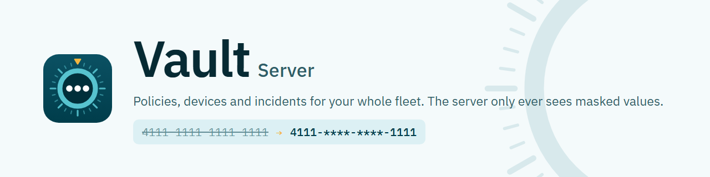

<picture>
  <source media="(prefers-color-scheme: dark)" srcset="assets/readme-server-dark.png">
  
</picture>

# Vault DLP Server — releases

Downloads and documentation for the **Vault DLP server**: the admin dashboard of the Vault data
loss prevention (DLP) system. Admins use it to define what counts as sensitive data, set policies,
manage the desktop agents and review incidents. The **desktop agents** on each PC do the detecting
and blocking; they're released separately in
[vault-dlp-agent-release](https://github.com/kudzaiprichard/vault-dlp-agent-release).

The server never sees the traffic itself, and it only ever stores **masked** values
(`4111-****-****-1111`): an agent that sends anything that looks unmasked is refused.

**[Download the latest release](https://github.com/kudzaiprichard/vault-dlp-server-release/releases/latest)**

## What you get

Each release is one zip, `Vault-Server-v<version>-win-x64.zip`, with a `.sha256` checksum file.
It is **click-and-run**: the zip holds the server and everything it needs, so the PC needs
nothing else installed and no internet connection.

| Inside the zip              | What it is                                                                                |
| --------------------------- | ----------------------------------------------------------------------------------------- |
| `Setup Vault.cmd`           | Installs or upgrades Vault. Asks a few questions, or runs unattended from a settings file |
| `Vault Control.cmd`         | Start, stop, pause, status, logs, backup, restore, settings, uninstall                    |
| `READ ME FIRST.txt`         | Short instructions                                                                        |
| `server\`                   | The Vault server                                                                          |
| `node\`, `pgsql\`, `caddy\` | Node.js, PostgreSQL (the built-in database) and Caddy (HTTPS)                             |
| `vault.config.example.json` | Example settings for an unattended setup                                                  |

## Requirements

- 64-bit Windows 10 or 11, or Windows Server 2019 or later
- 4 GB RAM and 5 GB free disk space at least
- Administrator rights to install it as a Windows service (recommended)
- A free HTTPS port for the dashboard and agents (443 by default; setup suggests another if it's
  taken)

## Quick start

1. **Download** the zip and its `.sha256` file from the
   [latest release](https://github.com/kudzaiprichard/vault-dlp-server-release/releases/latest).
2. **Check the download** (PowerShell, in the download folder). The two values must match:

   ```powershell
   (Get-FileHash .\Vault-Server-v0.4.3-win-x64.zip -Algorithm SHA256).Hash.ToLower()
   Get-Content .\Vault-Server-v0.4.3-win-x64.zip.sha256
   ```

3. **Extract** the zip (right-click > _Extract All_). Don't run it from inside the zip.
4. **Run `Setup Vault.cmd`.** It shows recommended settings for this PC, picked so nothing
   clashes with what's already installed (free ports, folder and names). Press Enter to install
   with them and approve the Windows prompt. Answer _No_ to choose every setting yourself.
5. **Sign in.** Setup opens the dashboard and shows the first administrator's password once if
   it generated one. You'll choose a new password at first sign-in.
6. **Connect the agents:** _Devices > Download agent_ (see [Connecting agents](docs/connecting-agents.md)).

The full walkthrough, including unattended installs, is in the
[installation guide](docs/installation.md).

## Everyday use

Double-click **Vault Control** (in the install folder, or the desktop shortcut) for a menu, or run
it with a command:

```text
Vault Control.cmd status      what's running, the dashboard address, the version, the last backup
Vault Control.cmd start | stop | restart
Vault Control.cmd pause       stop, and don't start with the PC until "resume"
Vault Control.cmd resume
Vault Control.cmd open        open the dashboard
Vault Control.cmd logs        latest log lines (logs server|https|database|backup, -Follow)
Vault Control.cmd backup      back up the database now
Vault Control.cmd restore -File <backup.dump>
Vault Control.cmd config      change addresses, ports, run mode, backups, email
Vault Control.cmd uninstall   remove services and certificate (-RemoveData also deletes the data)
```

While the server is stopped or paused, agents keep protecting their PCs and queue their reports
until it's back. More in the [operations guide](docs/operations.md).

## Upgrading

Back up first (`Vault Control.cmd backup`), then extract the new release and run its
`Setup Vault.cmd` and press Enter at "Update and keep these settings?". It finds the existing
install and keeps the database, keys, settings and secrets. Agents keep trusting the server: its certificate authority doesn't change. See
[Upgrading](docs/operations.md#upgrading).

## Documentation

| Guide                                          | What's in it                                                                                 |
| ---------------------------------------------- | -------------------------------------------------------------------------------------------- |
| [Installation](docs/installation.md)           | Requirements, interactive and unattended setup, every setting, ports, firewall, certificates |
| [Operations](docs/operations.md)               | Vault Control, backups and restore, upgrading, logs, where things are, uninstalling          |
| [Connecting agents](docs/connecting-agents.md) | Agent packages from the dashboard, keys and approval, manual setup                           |
| [Admin guide](docs/admin-guide.md)             | Using the dashboard: policies, data types, AI services, devices, incidents                   |
| [Troubleshooting](docs/troubleshooting.md)     | Common problems and fixes                                                                    |

Release notes are on each [release](https://github.com/kudzaiprichard/vault-dlp-server-release/releases).

## Versions

Versions follow [semantic versioning](https://semver.org/). A **major** version means something
admins or agents must act on, such as an agent API change; **minor** adds features; **patch**
fixes. Versions below 1.0 are marked as pre-releases.

## Security

- Every download has a SHA-256 checksum. Check it before running setup.
- The bundled Node.js, Caddy and PostgreSQL are downloaded from their official sites when a release
  is built and checked against pinned hashes.
- The server works fully offline: no CDNs, web fonts, analytics or external sign-in providers.
- Secrets live in `<install folder>\server\.env`, readable by administrators only.

## License

[MIT](LICENSE). Node.js, Caddy and PostgreSQL keep their own licenses, included in their folders
in the zip.
